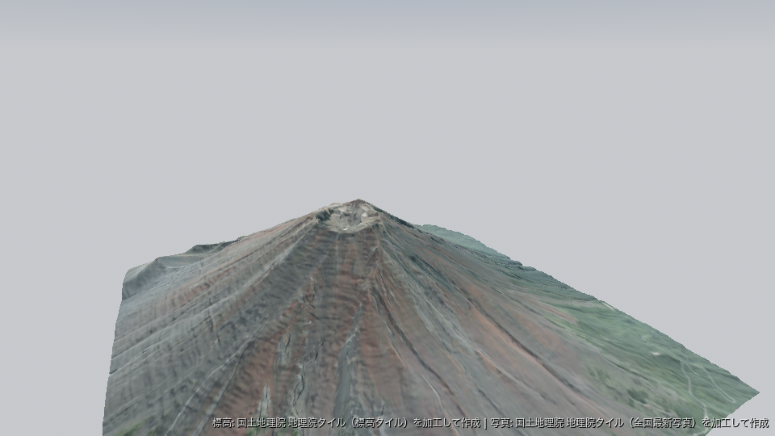
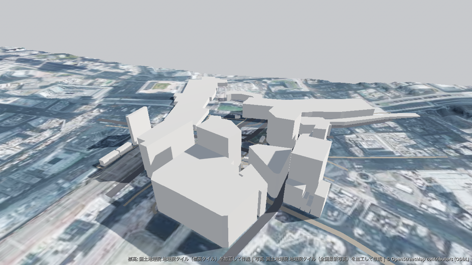

# Godot-Groundwork

Godot エディタ内の地図で範囲を選ぶだけで、**実世界の地形（距離 LOD 付き）・コリジョン・航空写真と
OpenStreetMap の建物・道路・水域を、Godot 標準ノードだけで構成された歩けるシーン**として生成するアドオンです。
glTF への書き出しや、ゲーム実行中の読み込みもできます。
GDScript のみで実装しており、GDExtension・GDAL・他のアドオンは不要です。



<sub>富士山頂 3 km × 3 km。出典：国土地理院「地理院タイル（標高タイル DEM10B、全国最新写真（シームレス））」を加工して作成</sub>



<sub>渋谷駅周辺。建物・道路 © OpenStreetMap contributors (ODbL)。出典：国土地理院「地理院タイル（標高タイル DEM5A、全国最新写真（シームレス））」を加工して作成</sub>

## クイックスタート

1. `addons/groundwork/` をプロジェクトにコピーし、*プロジェクト → プロジェクト設定 → プラグイン*
   で **Godot-Groundwork** を有効にします。右側に **Geo** ドックが表示されます。
2. 地名（または `緯度, 経度`）で検索し、地図上で **Shift+ドラッグ** して範囲を選択します。
   標高プロバイダ（その範囲で使えれば航空写真も）を選び、OpenStreetMap の **Buildings** / **Roads** / **Water** にチェックを入れます。
3. **Import** を押し、**Open Scene**（または **Add to Current Scene**）で開きます。

**Godot 4.4 以降**が必要です。

## 生成物

```
res://geo/<name>/
├── <name>.tscn            GwSceneRoot (Node3D)
│                            ├── Terrain → Chunk_XXX_YYY (MeshInstance3D)
│                            │             ├── Lod1, Lod2（距離で切り替わる粗い MeshInstance3D）
│                            │             └── StaticBody3D → CollisionShape3D (HeightMapShape3D)
│                            ├── Buildings → Chunk_XXX_YYY (MeshInstance3D) → …（ConcavePolygonShape3D）
│                            ├── Water (MeshInstance3D)
│                            └── Roads → Residential, Primary, …（道路クラスごとの MeshInstance3D）
├── georef.tres            GwGeoReference: 原点・スケール・帰属表示
├── heightfield.res        GwHeightfield: 標高グリッド全体
├── import_request.tres    同じ範囲・設定で再取り込みするための全パラメータ
├── ATTRIBUTION.md         帰属表示
├── terrain/               chunk_XXX_YYY.mesh / _lod1.mesh / .png / _collision.res
├── buildings/             chunk_XXX_YYY.mesh / _collision.res, building_material.tres
├── roads/                 <クラス>.mesh, <クラス>_material.tres
└── water/                 water.mesh, water_material.tres
```

- チャンク（既定 128 セル）は境界頂点を共有するため継ぎ目が出ません。
- **距離 LOD**: チャンクごとに粗いメッシュ（既定で 1/2 と 1/4）も作り、`visibility_range` で切り替えます。
  レベルの異なるチャンクの間の隙間は、境界から垂らした「スカート」で隠します。コリジョンは常に最高解像度です。
- メッシュとコリジョンは同じ高さ配列から作るので一致します。
- PNG テクスチャはエディタのインポートパイプラインに乗ります（VRAM 圧縮・mipmap）。
- シーンには帰属表示ラベル（`CanvasLayer`）が入ります。消す場合は別の場所（クレジット等）に表示してください。

## 座標系

範囲中心を原点とした Web メルカトルを近似メートルに換算した座標です。
**+X = 東、+Y = 上（標高 m）、−Z = 北**。北緯 35° で ±5 km なら誤差は約 0.05 % で、
ゲーム用途では無視できます。20 km 超・緯度 60° 超ではドックが警告を出します。

```gdscript
var world := $Shibuya as GwSceneRoot
var pos := world.geo_to_local(35.6595, 139.7005)     # y は地形の標高
var lat_lon := world.local_to_geo($Player.position)  # PackedFloat64Array [緯度, 経度]
var h := world.sample_elevation(Vector2(pos.x, pos.z))
```

## OpenStreetMap の建物・道路・水域

建物・道路・水域は、取り込み 1 回につき 1 回の [Overpass API](https://wiki.openstreetmap.org/wiki/Overpass_API)
クエリで取得します（範囲は 25 km² まで）。応答は `user://groundwork_cache/overpass/` に 7 日間キャッシュされます。

- **建物**は平屋根で押し出します。高さは `height` タグ、なければ `building:levels` × 3 m、なければ 6 m（どちらも変更可）。
  斜面で浮かないよう、壁は輪郭の最低地点の 0.5 m 下から立ち上げます。中庭（マルチポリゴンの内側リング）は
  屋根から抜き、中庭側にも壁を立てます。地形チャンク単位で結合し、`ConcavePolygonShape3D` のコリジョンを付けます。
- **道路**は地形に沿わせた帯状のメッシュです。幅は `highway=*` の種類ごとの表に従い
  （`GwImportRequest.road_widths` で上書き可）、クラスごとにメッシュとマテリアルを分けます。
  道路自体のコリジョンはなく、下の地形のコリジョンの上を歩きます。
- **水域**: 湖・池・貯水池・川の水面（島は抜く）を地形のすぐ上に沿わせます（多くの標高データでは水面の高さが地形になっています）。
  川・小川・運河は帯状のメッシュにします。コリジョンはありません。
- マテリアルは `building_material.tres`・`<クラス>_material.tres`・`water_material.tres` として保存されます。自由に編集でき、再取り込みしても編集後のマテリアルが保たれます。
- 現状の制限: 屋根は平屋根のみ、トンネルと地下の道は除外、橋は地形に沿う、交差点は重ねるだけ。

公開 Overpass サーバーはボランティアが運営しており、混雑していることがよくあります。ドックは overpass-api.de、
次にミラーを試し、取得に失敗しても建物・道路・水域が省かれるだけで地形の取り込みは完了します。大量利用や商用利用では、
自前または有料の Overpass サーバーを指す `GwTileProvider`（種別 *Vector*）を `res://groundwork_providers/` に置いてください。

## プロバイダ

| プロバイダ | 種別 | 範囲 | 最高解像度 | 備考 |
|---|---|---|---|---|
| Terrain Tiles（AWS, Terrarium） | 標高 | 全球 | z15（北緯35°で約3.9 m） | SRTM・3DEP・EU-DEM 等の合成 |
| Mapterhorn | 標高 | 全球 | z16・512 px（北緯35°で約1 m） | オープンデータ。解像度は地域によって異なる（[出典一覧](https://mapterhorn.com/attribution)） |
| 地理院 DEM1A | 標高 | 日本（一部） | z17（1 m） | 航空レーザ測量の範囲のみ |
| 地理院 DEM5A | 標高 | 日本（一部） | z15（5 m） | |
| 地理院 DEM10B | 標高 | 日本 | z14（10 m） | |
| 地理院 全国最新写真（シームレス） | 航空写真 | 日本 | z18 | |
| OpenStreetMap・地理院 淡色地図 | 背景地図 | — | — | ドック表示専用。生成物には使いません |
| Overpass API（overpass-api.de、private.coffee ミラー） | 建物・道路・水域 | 全球 | — | OpenStreetMap データ（ODbL） |

選んだズームにタイルがない場所（高解像度データの範囲外や、一部しかカバーしていないプロバイダ）では、
一番近い低ズームのタイルから切り出して補います。それでも欠ける部分は補間します。
512 px タイルのプロバイダ（`GwTileProvider.tile_size`）は解像度を落とさずに使います。

公開サーバーへの負荷を抑えるため、1 回の取り込みで取得するタイルは標高と航空写真を合わせて 5,000 枚までです
（2,000 枚を超えると警告が出ます）。広い範囲は分けて取り込むか、解像度や航空写真の細かさを下げてください。

全球の航空写真プリセットは、ゲームへの組み込み可否を規約で確認できたものだけを同梱する方針のため、
まだ含めていません。独自のプロバイダは `GwTileProvider` リソース（URL テンプレート
`https://…/{z}/{x}/{y}.png`、ズーム範囲、帰属表示）を `res://groundwork_providers/` に置けば
ドックに表示されます。API キーは URL に `{key}` と書き、*エディタ設定 → groundwork/api_keys/<プロバイダ id>*
に設定します（プロジェクトのファイルには書き込まれません）。

## 帰属表示の義務

どのプロバイダも、データを表示する場所での出典表示を求めています。取り込みごとに
`ATTRIBUTION.md` と `GwGeoReference.attribution` に正確な文言を書き出し、画面上のラベルも追加します。
ラベルを外す場合はゲームのクレジット等に表示してください。商用利用の前に各規約（`ATTRIBUTION.md` にリンクあり）を確認してください。

建物と道路は OpenStreetMap データの「生成物（Produced Work）」です。「© OpenStreetMap contributors」と表示し、
データが [ODbL](https://www.openstreetmap.org/copyright) で提供されていることを、スプラッシュ画面やクレジットなどで明示してください。

## スクリプトから使う

ドックはコア API の薄い UI です。同じ処理を自作のツールスクリプトからも呼べます。

```gdscript
var req := GwImportRequest.new()
req.bbox = GwGeoBBox.from_sw_ne(35.65, 139.69, 35.68, 139.72)
req.import_name = "shibuya"
req.output_dir = "res://geo/"
req.elevation_provider = GwProviderRegistry.find("terrarium_aws")
req.imagery_provider = GwProviderRegistry.find("gsi_seamlessphoto")
req.target_resolution_m = 10.0
req.include_buildings = true
req.include_roads = true

var builder := GwWorldBuilder.new()
builder.progress.connect(func(stage, done, total): print(stage, " ", done, "/", total))
var result: GwImportResult = await builder.build(req)
if result.ok:
	print(result.scene_path, result.warnings)
else:
	push_error(result.error_message)
```

`GwWorldBuilder.build_nodes(req)` はファイルを書かずにメモリ上のシーンを返します。

### glTF への書き出し

取り込み後にドックの **Export glTF…** ボタンを押すか、コードから書き出します。

```gdscript
var scene := (load("res://geo/shibuya/shibuya.tscn") as PackedScene).instantiate()
GwGltfExporter.export_scene(scene, "user://shibuya.glb")
scene.free()
```

地形（最高解像度）・建物・道路・水域をテクスチャ埋め込みで書き出します。コリジョン、粗い LOD、帰属表示ラベルは含めません。
書き出したファイルを使う場所でも、データの出典表示を続けてください。

### ゲーム実行中に読み込む

`GwTerrainLoader` は、ゲームの実行中にファイルを書かずにシーンを生成します（タイルは `user://` にキャッシュ）。
`demo/runtime.tscn` に例があります。

```gdscript
var loader := GwTerrainLoader.new()
loader.request = GwTerrainLoader.request_around(35.3606, 138.7274, 2000.0)
add_child(loader)
var result: GwImportResult = await loader.build()
if result.ok:
	var h := loader.scene_root.sample_elevation(Vector2.ZERO)
```

ゲーム内でデータの出典（`loader.scene_root.get_attribution()`）を表示してください。

この場合、タイル（有効にすれば OpenStreetMap のデータも）はプレイヤーそれぞれのゲームが直接ダウンロードします。
プリセットのプロバイダは、ボランティアや支援企業、行政が運営する無料の公開サーバーで、利用規約ではプレイヤー全員分の
通信が合算されます。多くの人が遊ぶゲームでは、エディタで取り込んだシーンを同梱するか、プロバイダを自前のタイルサーバー・
Overpass サーバーに向けてください。

通信には、プロジェクト名とバージョン（`application/config/name`・`application/config/version`）から作った
User-Agent が付きます。連絡先も含めたい場合は `loader.user_agent` を設定してください（例: `"MyGame/1.2 (+https://example.com)"`）。

## 設定

| 置き場所 | キー | |
|---|---|---|
| エディタ設定 | `groundwork/network/concurrency` | 同時ダウンロード数（既定 6） |
| エディタ設定 | `groundwork/geocoder/enabled` | Nominatim による地名検索 |
| エディタ設定 | `groundwork/api_keys/<id>` | プロバイダごとの API キー |
| プロジェクト設定 | `groundwork/defaults/*` | 既定のプロバイダ・解像度・出力先 |
| プロジェクト設定 | `groundwork/log_level` | コンソールのログレベル。直近の取り込みの全ログは `user://groundwork_last_import.log` |

取得したタイルは `user://groundwork_cache/`（プロジェクト単位）にキャッシュされ、ドックからサイズ確認・消去ができます。

## ロードマップ

- **今後**: 切妻などの屋根、土地利用、GeoTIFF / GeoJSON 読み込み、他のエクスポートアダプタ（Terrain3D・HTerrain）、他の座標系（UTM・平面直角座標系）での座標出力

## 開発

リポジトリのルートが Godot プロジェクトです。`demo/main.tscn` は `demo` という名前で取り込んだ範囲を歩くデモ、`demo/runtime.tscn` はゲーム実行中に地形を読み込むデモです。

```bash
./tools/install_gdunit4.sh
godot --headless --path . --import
godot --headless --path . -s res://addons/gdUnit4/bin/GdUnitCmdTool.gd --ignoreHeadlessMode -a res://addons/groundwork/tests/unit
```

ユニットテストはオフライン（合成タイル）で動きます。ネットワークがあれば、ドック経由で実際に取り込むエディタ統合テストも実行できます。

```bash
godot --headless --editor --path . -- --groundwork-selftest
```

Lint / format は [gdtoolkit](https://github.com/Scony/godot-gdscript-toolkit) 4.x を使います：
`gdlint addons/groundwork demo tools`、`gdformat --check addons/groundwork demo tools`。
`git config core.hooksPath tools/hooks` を実行しておくと、コミットのたびにステージしたファイルに対して両方が走ります。

## ライセンス

コード: [LICENSE](LICENSE) を参照。生成物に含まれる地理データは各プロバイダのライセンスに従います（取り込みごとの `ATTRIBUTION.md` を参照）。
